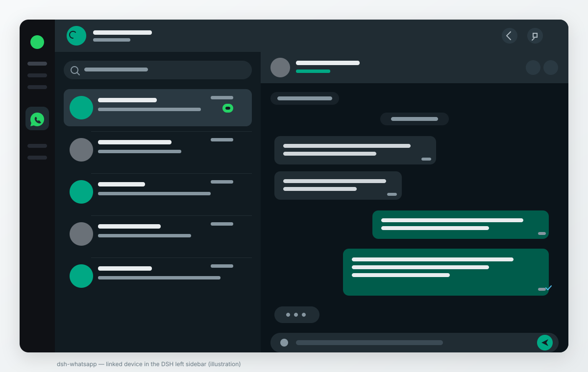

# dsh-whatsapp

A DeepSeek Harness (DSH) plugin that puts a **WhatsApp Web–style linked device** in
the DSH left sidebar. It mirrors a personal WhatsApp account on the computer: send
and receive messages, share files, and keep chats in sync in real time — without a
separate WhatsApp application.

> **Unofficial client. Use at your own risk.** WhatsApp has no public API for
> personal accounts. This plugin links through the WhatsApp Web multi-device
> protocol using the open-source [Baileys] library. That is against WhatsApp's
> Terms of Service for unofficial clients and can get the linked number
> **banned**, including a permanent ban. Do not use an account you cannot afford
> to lose, and do not use it for bulk or automated messaging. This project is not
> affiliated with or endorsed by WhatsApp or Meta. See
> [docs/FEASIBILITY.md](docs/FEASIBILITY.md).



## What it does

| Area | Status |
| --- | --- |
| Link the phone once by scanning a QR code (WhatsApp → Linked devices) | Yes |
| Behave as an independent linked device with its own end-to-end encrypted connection | Yes |
| Keep working while the primary phone is off or offline | Yes, within WhatsApp's linked-device rules (about 14 days since last use) |
| Send and receive text messages, replies, emoji, mentions | Yes |
| Send and receive photos, video, audio and documents; download media | Yes |
| Chat list, search, unread counts, history sync, read receipts, typing, presence | Yes |
| Groups | Yes (send/receive, participant names, group metadata) |
| Voice/video calls | **Not implemented** — incoming calls are shown with a working Reject action, but this client cannot carry call audio/video. See below. |
| Status/stories, channels/newsletters, disappearing-message management, payments | Not implemented |
| Persist the linked session securely between launches | Yes — AES-256-GCM at rest |

The design deliberately does not fake the missing parts. The call buttons are
disabled and explain why; the linked-device limits are shown in Settings.

## Requirements

- DeepSeek Harness **0.2.0 or newer** (tested against 0.2.2-rc.1; the manifest
  declares `engines.dsh: ">=0.2.0"`).
- A phone with WhatsApp, and a data connection for the computer.
- Node.js 22.5+ (DSH 0.2.2's runtime is newer).
- A QR scan from the phone, once per link.

## Install

### From a packed tarball (recommended)

```sh
cd dsh-whatsapp
npm install
npm pack                       # produces dsh-whatsapp-0.1.1.tgz
dsh plugin add "$PWD/dsh-whatsapp-0.1.1.tgz"
```

Restart DSH if the plugin manager says a restart is required. The **WhatsApp** row
appears in the left sidebar; open it to start linking.

If you installed while DSH was already running and the row is not there, restart
DSH once. The running host caches a failed module import from an earlier copy;
a fresh process loads the fixed bundle. On a normal install, no hot-reload
failure occurs.

### From the GitHub release

Download `dsh-whatsapp-0.1.1.tgz` from the
[latest release](https://github.com/AJN-Tech/dsh-whatsapp/releases/latest) and:

```sh
dsh plugin add /path/to/dsh-whatsapp-0.1.1.tgz
```

### From a source checkout (development)

```sh
git clone https://github.com/AJN-Tech/dsh-whatsapp.git
cd dsh-whatsapp
npm install
dsh plugin add "$PWD"
dsh plugin dev "$PWD" --host http://127.0.0.1:46739   # push client.js without a restart
```

### If pnpm blocks dependency build scripts

`@whiskeysockets/baileys` and `protobufjs` declare install scripts. Recent pnpm
versions block them until approved. DSH's plugin manager reports the pending
names; approve them in the web UI ("Allow these scripts and retry") or install
with the approved-builds option. They only run a Node-version check and a
Protobuf codegen step; the shipped Baileys build does not need more. If you are
installing manually, `npm install --ignore-scripts` is enough for these two.

### First link

1. Open the **WhatsApp** entry in the DSH left sidebar.
2. On the phone: **WhatsApp → Settings → Linked devices → Link a device**.
3. Scan the QR shown in DSH. The phone asks to confirm the new device.
4. The plugin switches to the chat list and starts syncing history.

The device appears in the phone's linked-devices list as a browser/desktop
client. Up to four devices can be linked; this plugin is one of them.

## Linking persistence and security

- Device credentials and Signal keys are written to
  `${DSH_HOME:-~/.dsh}/whatsapp/` as AES-256-GCM sealed files, with a master key
  in `key.bin` (mode `0600`) inside a `0700` directory.
- Set `DSH_WHATSAPP_PASSPHRASE` before starting DSH to derive the key from a
  passphrase with scrypt instead; no `key.bin` is written. Changing or losing the
  passphrase means re-linking (the sealed state cannot be opened).
- Chat metadata and the local message cache are sealed with the same key.
- Media is downloaded on demand and cached **in memory only**; it is not written
  to plaintext on disk.
- The plugin never logs message bodies, credentials, keys, QR payloads, cookies
  or media bytes. It has no telemetry and makes no network request except to
  WhatsApp's servers.
- The local API is served under DSH's authenticated web server; every route runs
  the same connection/owner check DSH's first-party routes use, and the API is
  unavailable to other OS users by default.

Full threat model: [docs/SECURITY.md](docs/SECURITY.md).

## Calls: what is limited and why

Voice and video calls are **not implemented**. Baileys implements WhatsApp's
multi-device messaging and the call *signalling* events it receives (offer,
ringing, accept, reject, terminate), but it has no WebRTC media transport and
WhatsApp publishes no media API for linked devices. A "call" button that only
signals without carrying audio would be a fake call, so this plugin does not
pretend to place calls.

What does work: an incoming call raises a banner with the caller and **Reject**
(`sock.rejectCall`). The header call buttons are disabled with an explanation.
Everything else listed above is real. See [docs/FEASIBILITY.md](docs/FEASIBILITY.md).

## Phone-offline behaviour

A linked device keeps its own encrypted connection to WhatsApp. It can send and
receive while the primary phone is off, and messages sent to the account are
delivered to the linked device. WhatsApp unlinks a device that has not been used
for roughly 14 days; after that the plugin shows the re-link screen and you scan
again. If you need calls, use the phone or WhatsApp Web/Desktop directly.

## Data and uninstall

State lives in `${DSH_HOME:-~/.dsh}/whatsapp/`:

```
creds.enc   sealed device credentials
keys.enc    sealed Signal session/pre-key/sender-key state
store.enc   sealed local chat/message cache
device.json sealed link metadata (not required to reconnect)
key.bin     master key (absent in passphrase mode)
salt.bin    scrypt salt (passphrase mode only)
```

Use **Settings → Log out** (or Re-link) in the plugin to unlink the device and
wipe the sealed credentials and this device's cached chats. Re-linking also wipes
the cache, because the next account linked here must not inherit the previous
account's chats. Uninstalling does not delete the directory:

```sh
dsh plugin remove dsh-whatsapp
rm -rf "${DSH_HOME:-$HOME/.dsh}/whatsapp"
```

## Development and tests

```sh
npm install
npm test                 # node --test, no network and no real WhatsApp connection
npm run check            # node --check on every source file
npx dsh-plugin-toolkit doctor .
npm pack --dry-run
```

`dsh-plugin-toolkit doctor` passes. Its `verify` command mounts a plugin at the
right-sidebar slot `sidebar.right.pane.tab`; this plugin registers the left
`sidebar.panellist` entry plus the full-page `main` slot, so `verify` stops at
the mount step by design. The same installed bundle is mounted against `main` by
`test/client.test.mjs` (the toolkit's own `mountClient` helper), which is the
relevant proof for this plugin.

Tests cover the encrypted vault, auth-state round-trips, message mapping, the
bounded/encrypted message store, reconnect classification and backoff, HTTP route
behaviour with a fake service, and the client bundle mounted in jsdom against a
stubbed API. They never link a real account.

The live-linking path (QR scan, history sync, media upload/download) cannot be
exercised in CI without a WhatsApp account; the README states this rather than
claiming it was tested end-to-end here.

Architecture: [docs/ARCHITECTURE.md](docs/ARCHITECTURE.md). Feasibility, library
choice and risk: [docs/FEASIBILITY.md](docs/FEASIBILITY.md). Security:
[docs/SECURITY.md](docs/SECURITY.md). Troubleshooting:
[docs/TROUBLESHOOTING.md](docs/TROUBLESHOOTING.md).

## License and disclaimer

MIT. See [LICENSE](LICENSE). Use of WhatsApp is governed by WhatsApp's own terms;
this project is not affiliated with WhatsApp or Meta. The authors accept no
liability for account bans, data loss, or misuse.

[Baileys]: https://github.com/WhiskeySockets/Baileys
